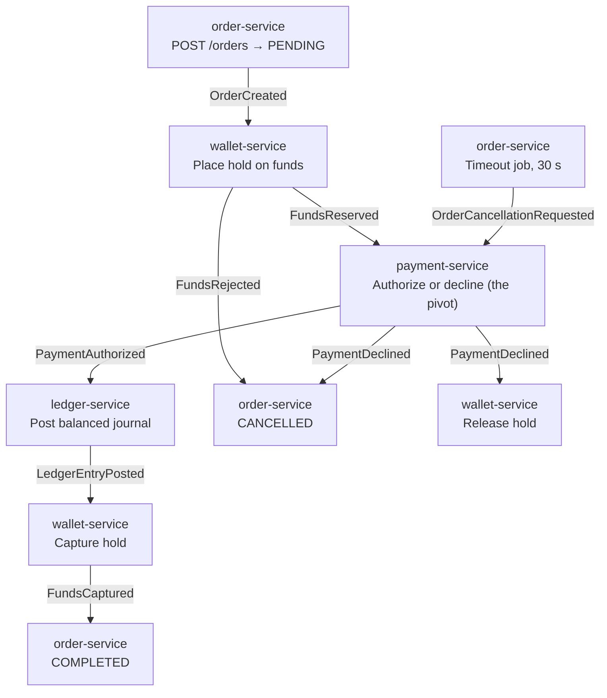

# payment-ledger

Four Spring Boot services (plus notifications) that place an order, debit a wallet and settle a
double-entry ledger, coordinated over Kafka by a **choreographed saga**. The point of the project
is that it stays correct when a service crashes mid-transaction, when Kafka redelivers a message,
or when events arrive out of order.

- An order ends in exactly one terminal state: `COMPLETED` or `CANCELLED`. Never stuck, never
  half-applied.
- No double charge, no lost money: the ledger always balances, checked by an invariant job every
  30 seconds.
- The database write and the event publish are atomic, through a **transactional outbox** relayed
  by **Debezium** change streams.
- Every consumer is **idempotent**: processing the same event twice has the same effect as once.
- A scripted chaos suite kills services mid-saga and shows recovery with the ledger still
  balanced.

The full specification is `docs/SPEC.md`; every non-obvious choice and every deviation from it is
recorded in `docs/DECISIONS.md`.

## The saga



Every arrow is an outbox document relayed by Debezium to Kafka, and every receiver skips
duplicates. **payment-service is the single decision point**: authorization is the saga's pivot,
and both the authorization and the timeout are decided against the same `payments` document, so a
timeout can never cancel an order that was just authorized. After `PAYMENT_AUTHORIZED` there is
no cancellation, only forward recovery.

## Quick start

```bash
make up         # builds the images and starts the whole stack, then registers the connectors
make verify     # checks all four invariants through the public APIs
make test       # the test suite (needs Docker: Testcontainers starts real Mongo and Kafka)
make chaos-1    # ... through chaos-9, each one ends with verify.sh
make down       # stop everything and delete the volumes
```

`make up` starts: a 3-node MongoDB replica set (required for multi-document transactions and the
change streams Debezium reads), 3 Kafka brokers in KRaft mode, Kafka Connect with Debezium, the
five services, Prometheus, Grafana, a Kafka exporter and Kafka UI.

| What | Where |
| --- | --- |
| Swagger UI per service | http://localhost:8081/swagger-ui.html … 8085 |
| Grafana (anonymous, provisioned dashboard) | http://localhost:3000 |
| Prometheus | http://localhost:9090 |
| Kafka UI | http://localhost:8090 |
| Kafka Connect | http://localhost:8083/connectors |

Every API call needs `X-Api-Key: dev-key` (override with `API_KEY`), and every POST that moves
money needs an `Idempotency-Key`. Errors are RFC 7807 `application/problem+json`.

```bash
# a purchase, end to end
KEY='X-Api-Key: dev-key'; JSON='Content-Type: application/json'
wallet=$(curl -sS -X POST localhost:8082/api/v1/wallets -H "$KEY" -H "$JSON" \
  -d '{"ownerId":"u-7","currency":"INR"}' | jq -r .walletId)
curl -sS -X POST localhost:8082/api/v1/wallets/$wallet/top-ups \
  -H "$KEY" -H "$JSON" -H "Idempotency-Key: $(uuidgen)" -d '{"amountMinor":100000}'
order=$(curl -sS -X POST localhost:8081/api/v1/orders -H "$KEY" -H "$JSON" \
  -H "Idempotency-Key: $(uuidgen)" \
  -d "{\"walletId\":\"$wallet\",\"merchantId\":\"m-42\",\"amountMinor\":49900,\"currency\":\"INR\"}" \
  | jq -r .orderId)
curl -sS localhost:8081/api/v1/orders/$order -H "$KEY" | jq '{status, history}'
curl -sS "localhost:8084/api/v1/ledger/journals?sourceRef=order:$order" -H "$KEY" | jq .
```

## Layout

```
common/                 event records, outbox + idempotency + consumer template, API plumbing, DLT
order-service/          API entry point, order state machine, saga timeout job        :8081
wallet-service/         wallets, holds, top-ups                                       :8082
payment-service/        simulated processor, the saga's pivot decision                :8083
ledger-service/         double-entry journal, invariant checker                       :8084
notification-service/   non-blocking retries + DLT demo                               :8085
arch-tests/             ArchUnit rules that span every module
infra/                  docker-compose, mongo replica-set init, debezium connectors,
                        prometheus, provisioned grafana dashboard
chaos/                  numbered scenario scripts + verify.sh
load-test/              k6 script
docs/                   SPEC.md, DECISIONS.md
```

## How correctness is achieved

| Concern | Mechanism |
| --- | --- |
| Atomic state change + event | `OutboxPublisher` writes the `outbox` document in the same MongoDB transaction. An ArchUnit test fails the build if any class outside `common` touches `KafkaTemplate`. |
| At-least-once delivery, exactly-once effects | `EventListenerSupport`: duplicate pre-check, marker insert and handler in one transaction, offset committed only after the commit (see ADR-002). |
| Natural backstops | unique indexes on `holds.orderId`, `payments._id` (= orderId) and `journal_entries.sourceRef`. |
| No overdraft | one conditional `findAndModify` with `$expr` and `$inc` - a balance is never read and written back - plus a `$expr` collection validator as the last line of defence. |
| Out-of-order events | the order state machine is monotonic by rank; a late event is ignored but still appended to `history` (ADR-013). |
| No stuck orders | a 5-second job claims timed-out orders with one conditional update and asks payment-service to decide; order-service never cancels on its own timer. |
| Ledger integrity | `JournalBuilder` refuses an unbalanced journal, postings are embedded so a partial journal cannot exist, and the invariant job re-checks every 30s. |
| Retries | saga services use blocking retries (1s, 2s, 4s) to preserve per-order partition ordering; notification-service uses `@RetryableTopic`. Non-retryable failures go straight to `<topic>.<group>.DLT`, are stored in `dead_letters` and can be replayed with `POST /api/v1/admin/dlt/{id}/replay`. |

## Invariants

Checked every 30s by ledger-service (invariant 1) and by `chaos/verify.sh` (all four, through the
APIs - no service reads another service's database):

1. Every journal balances, total debits = total credits, cross-checked against the `accounts`
   running totals. Exposed at `GET /api/v1/ledger/invariants`, and as the
   `ledger_invariant_violations` gauge that must stay 0.
2. With no orders in flight, each wallet's balance equals `CUSTOMER:<walletId>` in the ledger.
3. No hold is `RESERVED` for an order in a terminal state.
4. No order is in a non-terminal state for longer than 5 minutes.

## Chaos scenarios

Each script ends with `chaos/verify.sh`, which waits for the saga to drain and exits non-zero on
any violation.

| # | Scenario | Expected |
| --- | --- | --- |
| 1 | wallet-service killed mid-batch | redelivered events skipped as duplicates, no double holds |
| 2 | payment-service down 60s | orders older than 30s cancel via the pivot, the rest complete |
| 3 | Debezium down 60s | outbox documents accumulate, then drain; no event lost |
| 4 | one Kafka broker killed | no message loss, producers and consumers continue |
| 5 | ledger-service down 2min after authorization | orders wait in `PAYMENT_AUTHORIZED`, never cancelled, complete after restart |
| 6 | full replay (offsets to earliest) | no balance changes, only `duplicate_events_skipped_total` rises |
| 7 | poison message | lands in the DLT at once, the partition keeps flowing |
| 8 | notification provider failing 70% | retry topics absorb it, the saga is unaffected |
| 9 | MongoDB primary steps down | transaction retries ride out the election, Debezium resumes from its token |

## Metrics

`saga_completed_total{outcome}`, `saga_duration_seconds` (p50/p95/p99), `saga_stuck_total`,
`duplicate_events_skipped_total{service}`, `dlt_messages_total{topic}`,
`ledger_invariant_violations`, plus consumer lag per group from the Kafka exporter. All on the
provisioned Grafana dashboard (`infra/grafana/dashboards/payment-ledger.json`); nothing is
configured by clicking. Logs are JSON with `orderId`, `eventId` and `traceId` in the MDC, and the
W3C `traceparent` is carried through the outbox document into the Kafka header, so one order is
one trace id across all five services.

## What is verified, and what is not

Verified here:

- `mvn test` is green: the order state machine (every legal and illegal transition), ledger
  journal building and fee rounding, the payment pivot rules, the ArchUnit rules, and a
  Testcontainers integration test against a **real MongoDB replica set and a real Kafka** that
  covers the outbox write, duplicate suppression on redelivery, rejection on insufficient funds
  and 50 concurrent orders on a wallet funded for exactly 10 (10 reserved, balance never
  negative).

Not yet run end to end, so treat as unproven:

- `make up` and the nine chaos scenarios. The Compose stack (3 Mongo + 3 Kafka + Connect + 5
  services + observability) wants roughly 8 GB of Docker memory.
- The Debezium outbox relay itself: the connector JSON is pinned and recorded in ADR-005, but
  `MongoEventRouter` property names move between releases, so expect to check
  `http://localhost:8083/connectors/wallet-outbox/status` on first boot.
- Load numbers. `make load` runs the k6 script; no throughput or p99 figure is published here
  because none has been measured.

## Troubleshooting

- **Testcontainers cannot find Docker.** Docker Desktop on macOS uses
  `~/.docker/run/docker.sock`; `make test` handles it, plain `mvn test` needs
  `DOCKER_HOST=unix://$HOME/.docker/run/docker.sock`. See ADR-016.
- **A connector is not running.** `make connectors` re-registers them idempotently;
  `curl localhost:8083/connectors/<name>/status` shows why.
- **An order sits in `PENDING`.** Check that Connect is up and the outbox is draining:
  `docker exec mongo-1 mongosh wallet_db --eval 'db.outbox.countDocuments()'`.
