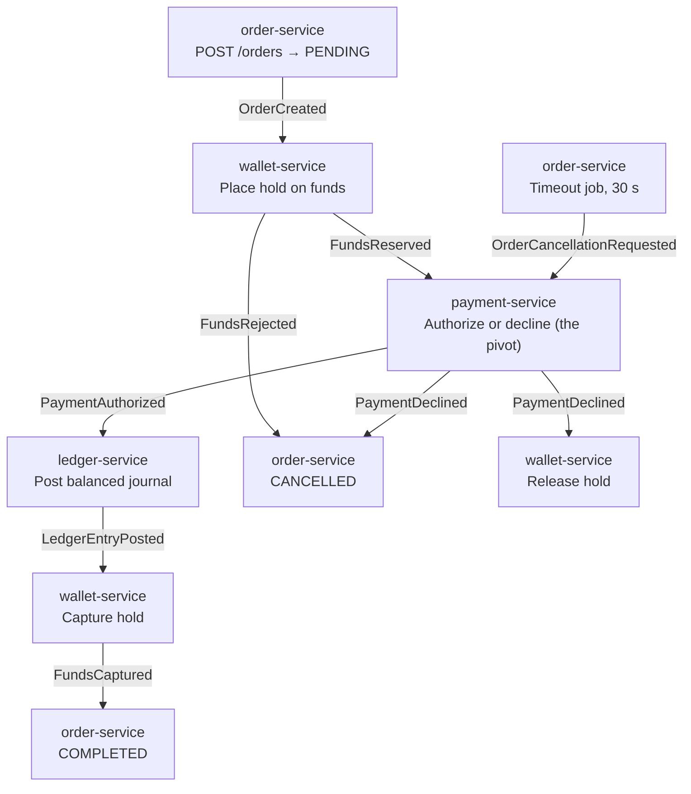

# Payment Ledger System — Implementation Spec (Spring Boot + Kafka)

## Overview

Build a payment system of four Spring Boot services that place an order, debit a wallet and settle a double-entry ledger, coordinated over Kafka by a choreographed saga. The system must stay correct when any service crashes mid-transaction, when Kafka redelivers a message, or when events arrive out of order. Correctness under failure is the point of the project, so it gets as much code and test effort as the happy path.

**Goals**

- An order ends in exactly one terminal state: `COMPLETED` or `CANCELLED`. It never stays stuck and is never half-applied.
- No double charge and no lost money: the ledger always balances (sum of debits = sum of credits), checked by an invariant job.
- The database write and the event publish are atomic, via the transactional outbox relayed by Debezium CDC.
- Every consumer is idempotent: processing the same event twice has the same effect as once.
- A scripted chaos demo kills services mid-saga and shows recovery, with the ledger still balanced.

**Non-goals**

- No real payment gateway, card data or PCI scope. The "bank" is a simulated wallet.
- No auth beyond a static API key header. No frontend beyond Swagger UI and Grafana.
- No Kubernetes. Everything runs with Docker Compose.
- No multi-currency FX. Each wallet has one currency; INR is the default.

## Tech stack and repo layout

Use Java 21 and Spring Boot 3.x with one MongoDB database per service on a shared replica set, Kafka in KRaft mode, and Debezium as the only path from a database to Kafka. MongoDB must run as a replica set, even locally, because multi-document transactions and change streams (which Debezium reads) require one.

| Concern | Choice | Notes |
| --- | --- | --- |
| Language | Java 21 | Records for events and DTOs; no Lombok |
| Framework | Spring Boot 3.x (latest stable) | Web, Data MongoDB, Spring Kafka, Actuator, Validation |
| Database | MongoDB 7.0+, 3-node replica set, one database per service | `MongoTransactionManager` for multi-document transactions |
| Schema and indexes | Mongock change units | Creates collections, `$jsonSchema`/`$expr` validators, unique and TTL indexes |
| Broker | Apache Kafka 3.x, KRaft, 3 brokers | Replication factor 3, `min.insync.replicas=2` |
| Outbox relay | Debezium MongoDB connector on Kafka Connect | MongoDB Outbox Event Router SMT (`MongoEventRouter`) |
| Serialization | JSON; `eventType` and `schemaVersion` in headers | Avro + Schema Registry is a stretch phase |
| Build | Maven multi-module | Parent POM pins all versions |
| Tests | JUnit 5, Testcontainers, Awaitility, ArchUnit | No mocked Kafka in integration tests |
| Observability | Micrometer, Prometheus, Grafana, OpenTelemetry to Jaeger, Kafka UI | All in Compose |
| Load test | k6 | Scripts in `load-test/` |
| Local run | Docker Compose + Makefile | `make up`, `make test`, `make chaos-N` |

```
payment-ledger/
  pom.xml                      # parent, dependency management
  common/                      # event records, outbox + idempotency helpers, tracing utils
  order-service/               # API entry point, order state machine, saga timeouts
  wallet-service/              # wallets, holds, top-ups
  payment-service/             # simulated processor, the saga's pivot decision
  ledger-service/              # double-entry journal, invariant checker
  notification-service/        # non-blocking retries + DLT demo
  infra/
    docker-compose.yml
    mongo/                     # replica-set init script, app users and roles
    debezium/                  # one connector JSON per service
    grafana/                   # provisioned dashboards
    prometheus.yml
  chaos/                       # numbered scenario scripts + verify.sh
  load-test/                   # k6 scripts
  docs/
    DECISIONS.md               # ADR log
  CLAUDE.md                    # rules from the last section of this spec
  Makefile
  README.md
```

## Architecture

Five services each own a MongoDB database and talk only through Kafka. There is no central orchestrator: each service reacts to the previous step's event (choreography). notification-service listens for `OrderCompleted` and `OrderCancelled` but is not part of the saga.



Every arrow is an outbox document relayed by Debezium to Kafka, and every receiver skips duplicates.

The happy path runs top to bottom. A rejection or decline before the pivot cancels the order and releases any hold. The timeout job only asks payment-service to decide, so an authorized order is never cancelled.

## Data model and ledger rules

All money is a `long` (BSON int64) in minor units (paise), never a double or `Decimal128`. Each service owns its own database on the shared replica set and never reads another service's database. Any write that touches more than one document (and a business document plus its outbox document always counts) runs in a multi-document transaction. All UUIDs use `uuidRepresentation=standard`.

Shapes below are shown as documents. Mongock creates each collection with its validator and indexes.

**Shared collections (in every service's database)**

```js
// outbox: field names match the Debezium MongoEventRouter defaults
{
  _id: UUID,                    // becomes the event id (Kafka header "id")
  aggregatetype: "wallet",      // routes to topic "wallet.events"
  aggregateid: "<orderId>",     // Kafka key (orderId, or walletId for top-ups)
  type: "FundsReserved",        // event type
  payload: { ... },             // event body
  traceparent: "00-...",
  createdAt: ISODate()
}
// index: TTL on createdAt, expireAfterSeconds 86400 (replaces a purge job)

// processed_events: the compound _id makes duplicates impossible
{ _id: { group: "wallet-service", eventId: UUID }, processedAt: ISODate() }
```

**order-service**

```js
// orders
{
  _id: UUID,
  walletId: UUID,
  merchantId: "m-42",
  amountMinor: NumberLong(49900),
  currency: "INR",
  status: "PENDING",                 // see state machine below
  cancelReason: null,
  cancellationRequestedAt: null,
  history: [                         // embedded, bounded (at most ~10 entries)
    { from: null, to: "PENDING", eventId: null, eventType: null, at: ISODate() }
  ],
  createdAt: ISODate(), updatedAt: ISODate(),
  version: NumberLong(0)             // Spring Data @Version
}
// validator: amountMinor is long >= 1; status in the enum
// index: { status: 1, createdAt: 1 } for the timeout job

// idempotency_keys
{ _id: "<Idempotency-Key>", requestHash: "...", response: { ... }, createdAt: ISODate() }
// index: TTL on createdAt, 24 h
```

Order states: `PENDING` → `FUNDS_RESERVED` → `PAYMENT_AUTHORIZED` → `LEDGER_POSTED` → `COMPLETED`. `CANCELLED` is reachable only from `PENDING` or `FUNDS_RESERVED`. A transition to an earlier state is ignored but still appended to `history`, because events from different topics can arrive in any order.

**wallet-service**

```js
// wallets
{
  _id: UUID, ownerId: "u-7", currency: "INR",
  balanceMinor: NumberLong(0),
  heldMinor: NumberLong(0),
  version: NumberLong(0)
}
// validator (last line of defence against overdraft):
// { $expr: { $and: [
//     { $gte: ["$heldMinor", 0] },
//     { $gte: [{ $subtract: ["$balanceMinor", "$heldMinor"] }, 0] } ] } }

// holds
{
  _id: UUID, walletId: UUID,
  orderId: UUID,                     // unique index: one hold per order, ever
  amountMinor: NumberLong(49900),
  status: "RESERVED",                // RESERVED | CAPTURED | RELEASED
  createdAt: ISODate(), updatedAt: ISODate()
}

// top_ups
{ _id: UUID, walletId: UUID, idempotencyKey: "...", amountMinor: NumberLong(100000), createdAt: ISODate() }
// index: unique on idempotencyKey
```

**payment-service**

```js
// payments: _id is the orderId, so there is exactly one decision per order
{
  _id: UUID,                         // orderId
  walletId: UUID, merchantId: "m-42", amountMinor: NumberLong(49900), currency: "INR",
  status: "AUTHORIZED",              // AUTHORIZED | DECLINED | VOIDED
  declineReason: null, processorRef: "sim-...",
  createdAt: ISODate(), updatedAt: ISODate(), version: NumberLong(0)
}
```

**ledger-service**

```js
// accounts: running totals, updated in the same transaction as the journal insert
{
  _id: "CUSTOMER:<walletId>",        // or MERCHANT:<merchantId>, CASH, FEE_REVENUE
  type: "LIABILITY",                 // ASSET | LIABILITY | REVENUE
  currency: "INR",
  debitTotalMinor: NumberLong(0),
  creditTotalMinor: NumberLong(0)
}

// journal_entries: postings are embedded, so a journal is written atomically as one document
{
  _id: UUID,
  sourceRef: "order:<orderId>",      // unique index ("topup:<topUpId>" for top-ups): blocks double posting
  description: "Order 9f3c...",
  postedAt: ISODate(),
  postings: [
    { account: "CUSTOMER:<walletId>", direction: "DEBIT",  amountMinor: NumberLong(49900) },
    { account: "FEE_REVENUE",         direction: "CREDIT", amountMinor: NumberLong(998) },
    { account: "MERCHANT:m-42",       direction: "CREDIT", amountMinor: NumberLong(48902) }
  ]
}
```

**Ledger rules**

- The ledger is append-only. The app's MongoDB user gets a custom role with only `find` and `insert` on `journal_entries` (no `update` or `remove`), set up in `infra/mongo/`. Mistakes are corrected with reversing entries.
- Every journal balances: sum of debits = sum of credits. A `JournalBuilder` refuses to build an unbalanced journal, and the invariant job double-checks. Because postings are embedded, a partial journal can't exist.
- Inserting a journal and `$inc`-ing each affected account's totals happen in one transaction. Accounts are upserted on first posting.
- Top-up of X: debit `CASH` X, credit `CUSTOMER:<walletId>` X.
- Purchase of X: debit `CUSTOMER:<walletId>` X, credit `FEE_REVENUE` fee, credit `MERCHANT:<merchantId>` X − fee. The fee is `X * feeBps / 10000` in integer arithmetic, rounded down, with `feeBps` configurable (default 200). The merchant gets the remainder, so the entry always balances (the example above: 49900 → fee 998, merchant 48902).

**Invariants** (checked every 30 s by ledger-service and by `chaos/verify.sh`)

1. Every journal balances, and total debits = total credits across all accounts. Check with an aggregation over `journal_entries`, and cross-check against the `accounts` totals.
2. With no orders in flight, each wallet's `balanceMinor` equals `creditTotalMinor − debitTotalMinor` of `CUSTOMER:<walletId>` in the ledger.
3. No hold is `RESERVED` for an order in a terminal state.
4. No order is in a non-terminal state for longer than 5 minutes.

## Events and Kafka topics

There is one topic per producing service. Saga events are keyed by `orderId`, so all events for one order from one service land on the same partition in order.

| Topic | Key | Producer | Consumed by | Partitions |
| --- | --- | --- | --- | --- |
| `order.events` | orderId | order | wallet, payment, notification | 6 |
| `wallet.events` | orderId (top-ups: walletId) | wallet | order, payment, ledger | 6 |
| `payment.events` | orderId | payment | order, wallet, ledger | 6 |
| `ledger.events` | orderId | ledger | order, wallet | 6 |

All topics use replication factor 3, `min.insync.replicas=2` and 7-day retention. Dead-letter topics are named `<topic>.<consumer-group>.DLT`. Each consumer filters by the `eventType` header and ignores types it doesn't handle.

**Envelope**

- Kafka headers: `id` (event UUID, the outbox document id), `eventType`, `schemaVersion`, `traceparent`.
- Key: `aggregateid`. Value: the payload JSON, which always includes `orderId` (except top-ups) and `occurredAt`.

**Events**

| Event | Producer | Payload (besides orderId, occurredAt) | Effect |
| --- | --- | --- | --- |
| OrderCreated | order | walletId, merchantId, amountMinor, currency | wallet places a hold |
| FundsReserved | wallet | holdId, walletId, merchantId, amountMinor, currency | payment decides; order → `FUNDS_RESERVED` |
| FundsRejected | wallet | reason: `INSUFFICIENT_FUNDS`, `WALLET_NOT_FOUND`, `CURRENCY_MISMATCH` | order → `CANCELLED` |
| PaymentAuthorized | payment | walletId, merchantId, amountMinor, currency, processorRef | ledger posts; order → `PAYMENT_AUTHORIZED` |
| PaymentDeclined | payment | reason: `PROCESSOR_DECLINED`, `TIMEOUT` | wallet releases the hold; order → `CANCELLED` |
| LedgerEntryPosted | ledger | journalId | wallet captures the hold; order → `LEDGER_POSTED` |
| FundsCaptured | wallet | walletId, amountMinor | order → `COMPLETED` |
| FundsReleased | wallet | holdId | order records history only |
| OrderCancellationRequested | order | reason: `TIMEOUT` | payment decides whether cancellation is still allowed |
| OrderCompleted | order | amountMinor | notification |
| OrderCancelled | order | reason | notification |
| WalletToppedUp | wallet | walletId, topUpId, amountMinor, currency | ledger posts the top-up journal |

**Schema evolution**: changes within a `schemaVersion` are additive only. Consumers ignore unknown fields (`FAIL_ON_UNKNOWN_PROPERTIES=false`). A breaking change gets a new `schemaVersion`, and consumers handle both versions until the old one is drained.

## Reliability rules

Delivery is at-least-once end to end. Exactly-once *effects* come from the outbox plus idempotent consumers, not from Kafka transactions.

**Transactional outbox**

- A state change and its outgoing event are written in one MongoDB transaction: the business document(s) plus an `outbox` document.
- Business code never calls `KafkaTemplate`. An ArchUnit test fails the build if any class outside `common` imports it.
- One Debezium MongoDB connector per service (`io.debezium.connector.mongodb.MongoDbConnector`) watches that service's `outbox` collection through change streams (`collection.include.list=<db>.outbox`). It applies `transforms=outbox` with `transforms.outbox.type=io.debezium.connector.mongodb.transforms.outbox.MongoEventRouter`, routes by `aggregatetype` to `${routedByValue}.events`, and places `type` and `traceparent` into the `eventType` and `traceparent` headers. MongoEventRouter property names have changed across Debezium releases, so pin the version and record the exact connector JSON in `docs/DECISIONS.md`.
- The connector's producer uses `acks=all` and `enable.idempotence=true`.
- A TTL index removes outbox documents after 24 hours. The router only acts on inserts, so set it to ignore the resulting delete events quietly.

**Idempotent consumers** (one template, in `common`)

```java
@KafkaListener(topics = "payment.events", groupId = "wallet-service")
public void on(ConsumerRecord<String, String> rec, Acknowledgment ack) {
    tx.executeWithoutResult(s -> {   // TransactionTemplate over MongoTransactionManager
        // insert { _id: {group, eventId} } into processed_events; DuplicateKeyException = already processed
        if (!processedEvents.markProcessed(GROUP, eventId(rec))) {
            metrics.duplicateSkipped(rec);
            return;
        }
        handler.handle(rec);   // business change + outbox documents, same transaction
    });
    ack.acknowledge();         // offset committed only after the DB commit
}
```

Consumer config: `enable.auto.commit=false`, `AckMode.MANUAL_IMMEDIATE`, `max.poll.records=50`. Natural unique keys back this up: `holds.orderId`, `payments._id` (the orderId) and `journal_entries.sourceRef`. A transaction that fails with a `TransientTransactionError` label (write conflict, primary election) is retried as a whole, up to 3 times, before the error handler's backoff takes over.

**Retries and dead letters**

- Saga services use **blocking** retries (`DefaultErrorHandler`, exponential backoff 1 s → 2 s → 4 s, 4 attempts) so per-order ordering on a partition is preserved.
- Non-retryable errors go straight to the DLT: deserialization failures, validation errors, unknown `schemaVersion`.
- notification-service uses **non-blocking** retries (`@RetryableTopic`, attempts at 5 s, 30 s and 2 min, then DLT), because notification order doesn't matter and a slow provider must not block the partition.
- Every DLT has a consumer that stores the record in a `dead_letters` collection and increments `dlt_messages_total`. An admin endpoint republishes one dead letter by id.

**Concurrency**

- wallet-service never reads a balance and then writes it. Placing a hold is one conditional update inside the transaction: `findOneAndUpdate({ _id: walletId, $expr: { $gte: [{ $subtract: ["$balanceMinor", "$heldMinor"] }, amount] } }, { $inc: { heldMinor: amount } })`. No match means insufficient funds. Capture (`$inc` balance and held by −amount) and release (`$inc` held by −amount) work the same way. The collection validator is the backstop.
- Order and payment documents use Spring Data `@Version` optimistic locking. On `OptimisticLockingFailureException`, retry the whole handler.

**Timeouts and the pivot**

- order-service runs a job every 5 s that finds orders in `PENDING` or `FUNDS_RESERVED` older than `saga.timeout` (default 30 s) with no cancellation request yet. It claims each order with `findOneAndUpdate({ status: { $in: [...] }, createdAt: { $lt: cutoff }, cancellationRequestedAt: null }, { $set: { cancellationRequestedAt: now } })`, so two instances never claim the same order, and emits `OrderCancellationRequested` once per order in the same transaction.
- **payment-service is the single decision point.** Payment authorization is the saga's pivot, and both the authorization and the timeout are decided against the same `payments` document:
    - Cancellation request and no document yet: insert `VOIDED`. A later `FundsReserved` then finds `VOIDED` and emits `PaymentDeclined(TIMEOUT)`.
    - Cancellation request and the document is `AUTHORIZED`: ignore the request. The order completes.
    - `FundsReserved` and no document: authorize or decline.
    - If both events race to insert the first document, the loser gets a `DuplicateKeyException` on `_id`, re-reads the document and applies the rules above.
- After `PAYMENT_AUTHORIZED` there is no cancellation, only forward recovery. Ledger posting and capture are retried until they succeed. An order stuck there for more than 5 minutes raises `saga_stuck_total`.
- order-service never cancels on its own timer. It cancels only on `FundsRejected` or `PaymentDeclined`. That removes the race where a timeout cancels an order that was just authorized.

## APIs

All endpoints are under `/api/v1`, need an `X-Api-Key` header, return RFC 7807 `application/problem+json` on errors, and are documented with springdoc (Swagger UI per service). Every POST that moves money needs an `Idempotency-Key` header. Replaying the same key with the same body returns the stored response. The same key with a different body returns 422.

| Service | Method and path | Purpose | Response |
| --- | --- | --- | --- |
| order | `POST /orders` | Start a purchase: walletId, merchantId, amountMinor, currency | 202 with orderId, status PENDING |
| order | `GET /orders/{id}` | Status plus the full status history | 200 |
| wallet | `POST /wallets` | Create a wallet: ownerId, currency | 201 |
| wallet | `POST /wallets/{id}/top-ups` | Add money (Idempotency-Key required) | 201 |
| wallet | `GET /wallets/{id}` | balance, held, available | 200 |
| payment | `GET /payments/{orderId}` | The payment decision | 200 |
| payment | `PUT /admin/processor` | Chaos knobs: declineRate (0–1), latencyMs, failRate (throws, to test retries) | 204 |
| ledger | `GET /ledger/accounts/{code}` | Account balance | 200 |
| ledger | `GET /ledger/journals?sourceRef=` | Journal with its postings | 200 |
| ledger | `GET /ledger/invariants` | Result and time of the last invariant check | 200 |
| notification | `GET /notifications?orderId=` | Sent notifications | 200 |
| notification | `PUT /admin/provider` | Chaos knob: failRate for the fake provider | 204 |
| all | `POST /admin/dlt/{id}/replay` | Republish one dead letter | 202 |

## Observability, testing and chaos

The demo is the chaos suite: every scenario below runs from a script, ends with `chaos/verify.sh`, and must leave all invariants green.

**Metrics** (Micrometer → Prometheus → one provisioned Grafana dashboard)

- `saga_completed_total{outcome}`, and `saga_duration_seconds` as a histogram (p50/p95/p99)
- `saga_stuck_total`, `duplicate_events_skipped_total{service}`, `dlt_messages_total{topic}`
- `ledger_invariant_violations`: a gauge that must stay 0, shown as a red panel
- Outbox relay lag per service via the Debezium connector's `MilliSecondsBehindSource` JMX metric, and consumer lag per group via a Kafka exporter

**Tracing and logs**: write the W3C `traceparent` into the outbox document, carry it as a Kafka header, and restore it in the consumer, so one order is one trace across all five services in Jaeger. Logs are JSON with `orderId`, `eventId` and `traceId` in the MDC.

**Tests**

- Unit: the order state machine (every legal and illegal transition), ledger journal building and fee rounding, and the payment pivot rules.
- Integration per service with Testcontainers (`MongoDBContainer`, which starts a single-node replica set, plus Kafka): a handler writes both the business document and the outbox document, a failure mid-handler leaves neither, and a duplicate event is skipped.
- End to end with Testcontainers Compose (full stack including Debezium): happy path, insufficient funds, processor decline, timeout before authorization, and a timeout racing an authorization (run 100 times, never inconsistent).
- Concurrency: one wallet with funds for exactly 10 orders gets 50 concurrent orders. Exactly 10 complete, 40 cancel, the balance never goes negative.
- Architecture (ArchUnit): no `KafkaTemplate` outside `common`, and no cross-service package imports.
- Load (k6): ramp to a sustained rate and record throughput, p99 saga latency and max consumer lag in the README. No fixed target; 100 orders/s on a laptop is a reasonable first goal.

**Chaos scenarios**

| # | Scenario | How | Expected |
| --- | --- | --- | --- |
| 1 | wallet-service killed mid-batch | `docker compose kill wallet-service` during load, then start | Redelivered events are skipped as duplicates; no double holds |
| 2 | payment-service down for 60 s | stop, wait, start | Orders older than 30 s cancel via timeout; the rest complete; nothing stuck |
| 3 | Kafka Connect (Debezium) down for 60 s | stop connect, wait, start | Outbox documents accumulate, then drain; no event lost |
| 4 | One Kafka broker killed | `docker compose kill kafka-2` | No message loss; producers and consumers continue |
| 5 | ledger-service down for 2 min after authorizations | stop ledger during load | Orders wait in `PAYMENT_AUTHORIZED`, are never cancelled, and complete after restart |
| 6 | Full replay | reset wallet-service's consumer group offsets to earliest | No balance changes; only `duplicate_events_skipped_total` rises |
| 7 | Poison message | publish malformed JSON to `payment.events` | Lands in the DLT at once; the partition keeps flowing |
| 8 | Flaky notifications | `PUT /admin/provider` with failRate 0.7 | Retry topics absorb it; the saga is unaffected |
| 9 | MongoDB primary fails over | `rs.stepDown()` on the primary during load | Retryable writes and transaction retries ride out the election; Debezium resumes from its resume token; no lost or doubled effects |

`chaos/verify.sh` waits until no orders are in flight, then checks all four invariants through the APIs and exits non-zero on any violation.

## Build phases

Build in eight phases, each ending with green tests and a commit. Don't start a phase until the previous one's "Done when" holds.

| Phase | Delivers | Done when |
| --- | --- | --- |
| 0. Skeleton | Maven modules, Compose (3 Kafka brokers, 3-node MongoDB replica set with init script, Connect, Kafka UI), Mongock setup, health endpoints, Makefile | `make up` brings everything healthy with the replica set initiated; `make test` passes |
| 1. Outbox path | common outbox + idempotency library, wallet create/top-up, ledger top-up posting, Debezium connectors | A top-up shows in the ledger; replaying the topic changes nothing |
| 2. Happy path | OrderCreated through FundsCaptured across all services | E2E test: order reaches COMPLETED, ledger balances, wallet matches ledger |
| 3. Compensation | FundsRejected, PaymentDeclined, timeouts, payment pivot | E2E tests for all cancel paths and the timeout race (100 runs) pass |
| 4. Hardening | API idempotency keys, conditional wallet updates, collection validators, ledger role, concurrency test, ArchUnit rules | The 50-orders-on-one-wallet test passes 20 times in a row |
| 5. Retries and DLT | Blocking retries in saga services, notification-service with retry topics, DLT store + replay | Chaos 7 and 8 pass |
| 6. Observability | Metrics, Grafana dashboard, tracing through the outbox, JSON logs | One order shows as one trace in Jaeger; the dashboard shows live sagas |
| 7. Chaos and docs | Chaos scripts 1–9, `verify.sh`, invariant job, k6 run, README | All 9 scenarios pass `verify.sh`; README has the diagram, failure table and load numbers |
| 8. Stretch | Avro + Schema Registry; a Kafka Streams fraud-velocity check; Debezium exactly-once source mode, if the pinned version supports it for MongoDB | Optional |

## Instructions for Claude Code

Copy these rules into `CLAUDE.md` at the repo root before the first session, and put this spec at `docs/SPEC.md`.

**Rules**

1. Work one phase at a time. Finish its "Done when" with passing tests, then commit with a message naming the phase.
2. Money is a `long` in minor units everywhere. No `double`, no `float`.
3. Never publish to Kafka from business code. Every outgoing event is an outbox document in the same transaction as the state change.
4. Every consumer goes through the shared idempotent handler template. No hand-rolled listeners.
5. Don't change an event's name, fields or topic without updating the events table in `docs/SPEC.md` and adding an entry to `docs/DECISIONS.md`.
6. Integration tests use Testcontainers with real MongoDB (replica set) and Kafka. No embedded Kafka, no embedded or mocked MongoDB, and no mocked brokers.
7. Record every non-obvious choice (library version, config value, deviation from this spec) as a short ADR in `docs/DECISIONS.md`.
8. If the spec is ambiguous or seems wrong, stop and ask rather than guessing, especially about the pivot and timeout rules.
9. Keep the Grafana dashboard and Debezium connector configs in the repo as files, provisioned automatically. Nothing is configured by clicking.
10. Any write that touches more than one document runs in a MongoDB transaction; a business document plus its outbox document always counts. Never read a balance and write it back: use conditional `findOneAndUpdate` with `$inc`.
11. Collections, validators and indexes are created only by Mongock change units, never by Spring Data auto-index creation (`auto-index-creation=false`).

**First prompt**

```text
Read docs/SPEC.md and CLAUDE.md. Implement Phase 0 only.
Show me the module layout and docker-compose services before writing code.
When Phase 0's "Done when" holds, run make test, commit, and stop.
```

After that, prompt one phase at a time: `Implement Phase N from docs/SPEC.md. Stop when its Done-when holds.`